# 🎧 Felpano Player

Aplicação Full Stack para biblioteca pessoal e reprodução de arquivos MP3 locais.

**Tecnologias:** PHP 8.2+, Laravel 12, Vue.js 3, Inertia.js, Tailwind CSS e Vite.

## Funcionalidades

- Biblioteca musical e pesquisa;
- Player com controles de reprodução;
- Autenticação e gerenciamento de perfis;
- Organização de músicas e interface responsiva.

## Instalação local

Instale as dependências com Composer e npm, configure o arquivo `.env`
a partir de `.env.example` e execute as migrations.

## Código-fonte

Portfólio com código Laravel e Vue para reprodução de arquivos locais.
Não inclui arquivos de áudio nem ferramentas de obtenção de áudio de terceiros.
